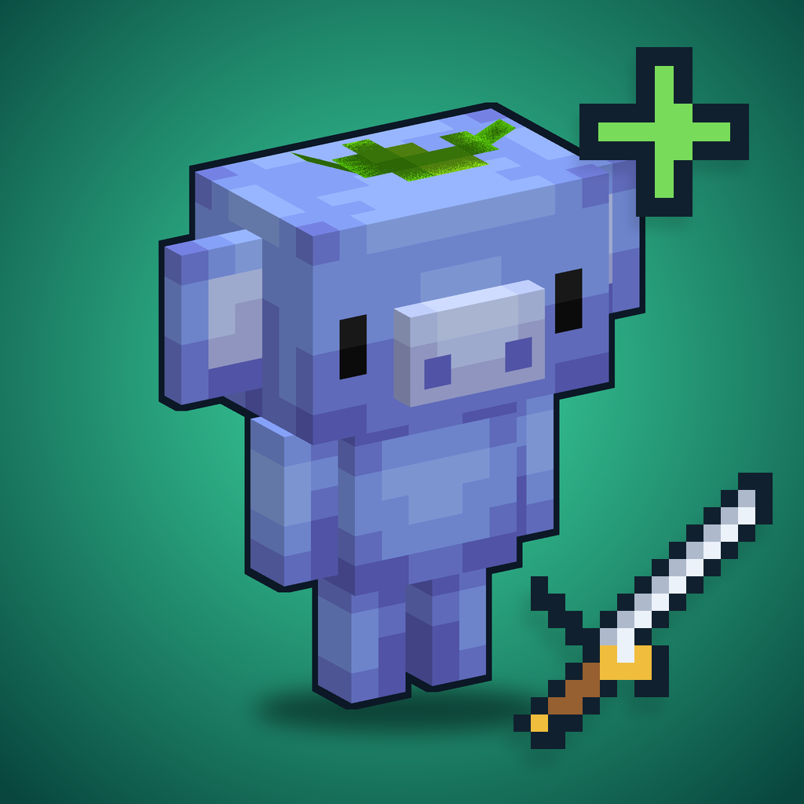

<p align="center"></p>

---

<center>
<a href="https://github.com/HyperGaming99/BetterMobCrucible/releases/latest"></a>
</center>

---

✨ What is BetterMobCrucible?
--

BetterMobCrucible is an addon for [BetterMob](https://github.com/HyperGaming99/bettermob) that
gives your custom items more ways to trigger skills. BetterMob already runs `~onUse`; this plugin
adds swinging, swapping hands, equipping, picking up, dropping and timers, plus a few
item mechanics and placeholders.

It was built so that item content made for MythicCrucible-style plugins can run on BetterMob.
If you know that file format, you already know this one.

- 🗡️ **More item triggers**: `~onSwing`, `~onPressF`, `~onEquip`, `~onPickup`, `~onDrop` and
  `~onTimer:<ticks>` in the same `Skills:` lists BetterMob already reads.
- 🏷️ **Item data**: store values on items with `setitemnbt` and read them back anywhere with
  `<itemnbt.key>`.
- 📜 **Lore on the fly**: rewrite an item's lore from a skill with `setlore`.
- ⚡ **Lightweight**: one timer for all items, and events exit early when no item uses the trigger.
- 🔌 **Built on the BetterMob API**: no MythicMobs needed.

## 🚀 Quick example

```yaml
# plugins/BetterMob/items/wand.yml
example_wand:
  Id: STICK
  Display: '&bExample Wand'
  Lore:
    - '&7Swing to count'
  Skills:
    - sound{s=entity.experience_orb.pickup} @self ~onUse
    - setitemnbt{key=swings;value=1} @self ~onSwing
    - setlore{lore=&7Swings: <itemnbt.swings>} @self ~onSwing
```

```
/bettermob give example_wand
/bmc reload
```

📋 Triggers, mechanics and placeholders
-

| Type | Name | Description |
|---|---|---|
| Trigger | `~onSwing` | Left click with the item in the main hand |
| Trigger | `~onPressF` | Item is swapped between hands |
| Trigger | `~onEquip` | Item is selected in the hotbar |
| Trigger | `~onPickup` / `~onDrop` | Item is picked up or dropped |
| Trigger | `~onTimer:<ticks>` | Repeats while the item is in the main hand |
| Mechanic | `setitemnbt{key=..;value=..}` | Stores a string on the held item |
| Mechanic | `setlore{lore=line 1\|line 2}` | Replaces the held item's lore |
| Placeholder | `<itemnbt.key>`, `<item.nbt.key>`, `<item.id>` | Needs a BetterMob build with the placeholder API |

`~onUse` stays with BetterMob. The extra triggers are registered in BetterMob (1.1.9 or newer), so
the load stays silent; older versions log them as invalid lines, which is harmless. They are written as skills into
`plugins/BetterMob/packs/BetterMobCrucible/skills/items.yml`, and BetterMob reloads when they change.

⌨️ Commands
-

| Command | Description |
|---|---|
| `/bettermobcrucible list` | Show the registered item triggers |
| `/bettermobcrucible reload` | Re-read the item files |
| `/bettermobcrucible debug` | Show the held item's BetterMob ID and stored data |

Alias: `/bmc`. Permission: `bettermobcrucible.admin` (default: op). Items are handed out with
BetterMob's `/bettermob give`.

🏗️ Supported environment
-
<a href="https://www.minecraft.net/en-us/download/server"></a>
<a href="https://adoptium.net/"></a>
<a href="https://papermc.io/downloads/folia"></a>
<a href="https://github.com/HyperGaming99/bettermob"></a>

🔨 Building
-

JDK 21:

```
mvn package
```

The BetterMob API classes under `src/main/java/eu/northsoft/bettermob/api` are a compile-only copy
(excluded from the jar, BetterMob provides them at runtime). Update them when the BetterMob API changes.
CI builds on every push to `main` and creates or updates the release `v<version>`.

📄 License
-

[MIT](LICENSE)
